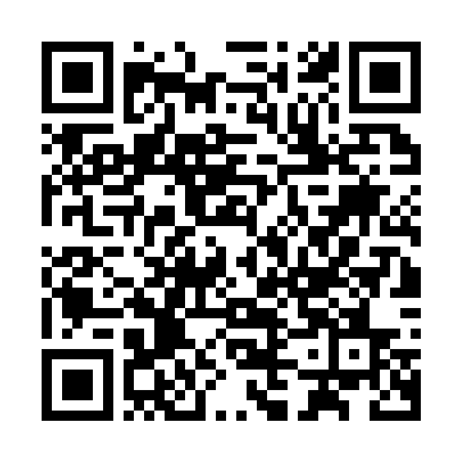

# 마이가든 설치

**현재 버전 1.3.4 · 빌드 19** · Android 9(API 28) 이상

[APK 다운로드](https://github.com/esbpark/mygarden-releases/releases/latest/download/MyGarden.apk) · [빌드 19 릴리스](https://github.com/esbpark/mygarden-releases/releases/tag/v1.3.4-build19) · [SHA-256 파일](https://github.com/esbpark/mygarden-releases/releases/latest/download/SHA256SUMS.txt)



1. Android 휴대폰 카메라로 QR을 스캔하거나 위 APK 다운로드 링크를 엽니다.
2. 내려받은 `MyGarden.apk`를 엽니다. Android에서 요청하면 해당 브라우저 또는 파일 앱에 이 앱 설치를 허용합니다.
3. **설치** 또는 **업데이트**를 누르고 마이가든을 엽니다.

빌드 19 SHA-256

```text
af8ab30ecf7aba7791b378bd62531d303568f5b65a8664de1398f649aa8e998c
```

빌드 19는 Android 디버그 인증서로 서명되었습니다. 기존 앱과 서명이 다르면 Android가 업데이트를 거부합니다. 기존 앱에 저장한 데이터가 있다면 제거하기 전에 보존 방법을 확인하세요.

빌드 6 이상에서는 마이가든을 열 때 최신 버전을 확인합니다. 새 버전 안내에서 **업데이트**를 누른 후 Android 설치 화면에서 확인하세요. 앱의 **설정**에서 현재 버전과 빌드 번호를 확인할 수 있습니다.

빌드 9부터 앱 홈 상단의 **QR** 버튼에서도 이 설치 QR을 열 수 있습니다.

## 다음 버전 배포

새 버전마다 새 GitHub Release를 만들고 설치 APK 이름을 **`MyGarden.apk`**로 유지합니다. SHA-256 파일을 함께 올리고, 최신 릴리스로 지정한 뒤 위 고정 링크를 비로그인으로 다운로드해 해시와 설치를 확인합니다. 안내의 버전과 해시를 갱신하면 이미 배포한 QR을 계속 사용할 수 있습니다.
